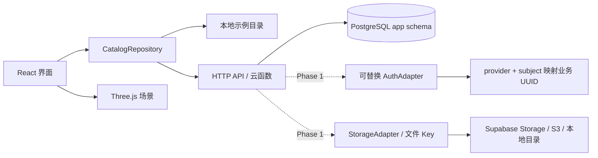
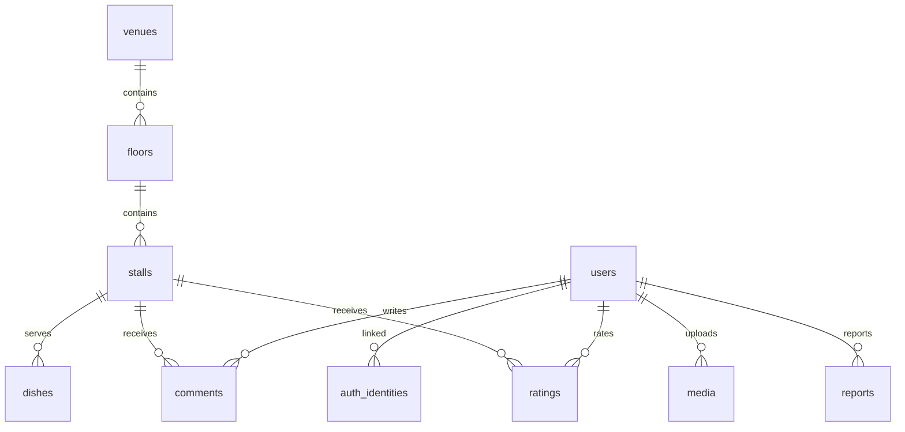

# 技术架构与路线

## 核心决定

1. **静态前端独立部署。** React/TypeScript/Vite 生成 `dist/`，既能发布 Pages，也能由学校 Nginx 托管。无需 Node 服务渲染页面。
2. **三维场景独立于业务数据。** 校园层采用相对坐标 SVG，普通建筑为白色直线多边形，交互点为浅彩矩形；Three.js 负责室内场景。后续建筑可换 glTF/GLB，稳定 ID 与相对位置不变。
3. **PostgreSQL 是业务数据的主存储。** 结构只通过版本迁移改变；不把 Supabase 平台专属认证 ID 作为业务用户主键，不向业务表写平台完整图片 URL。
4. **接口是迁移边界。** 界面只依赖 `CatalogRepository`。当前 mock 和 HTTP 两个实现路径；免费云阶段可用 Supabase Edge Function 实现同样契约，未来用仓库里的 Node API 替换。
5. **只读先行。** 不提前开放不完整的注册、评分或上传。Phase 0 的安全性来自没有客户端写入口，而非按钮置灰。

## 视图状态与空间关系

`View` 是带类型约束的三种状态：campus、building(venueId)、floor(venueId,floorId)。窗口详情在楼层状态上叠加。导航会清理不属于新视图的窗口选择。

校园 `x/y` 是 CAMPUS_PLAN_V2 图纸坐标，按参考图定位，无需绝对地理坐标。楼层采用米制局部坐标，Y 向上、X 向右、Z 朝图纸下方；窗口朝向使用弧度。渲染从 `floorId + position` 读取位置，不从列表下标推导位置。排序改变不会改变实体位置。

校园层用 SVG，进入建筑后使用独立 WebGL 场景；室内视角进行镜头插值。相对锚点用于关联场所，未来精细模型仍沿用稳定场所 ID。减少动画偏好会取消室内镜头插值。

## 数据关系

评分以 `(user_id, stall_id)` 唯一：同一用户修改评分，不重复计数。价格在数据库存整数分，展示时除以 100。审核通过后才允许进入公开聚合；当前 API 只输出已发布的食堂目录，不输出用户和审核内容。

## 下一阶段认证与存储契约

Phase 1 实现 `AuthAdapter.verify(accessToken) -> { provider, subject }`，由服务端查 `auth_identities` 获取业务 UUID 与角色。JWT 必须验证签名、issuer、audience、有效期；不能相信客户端上传的 user_id 或 role。管理员角色只能由受信任运维赋予。

`StorageAdapter` 负责 `createUploadTicket / inspect / publish / signedRead / delete`。公开照片只生成稳定公开 Key；未审核内容从私有 bucket 生成短时访问 URL。数据库只存 Key、hash、尺寸、字节数、审核状态、关联实体。不得将签名 URL 持久化。

## 分阶段验收

| 阶段     | 内容             | 可验收条件                                                         |
| -------- | ---------------- | ------------------------------------------------------------------ |
| Phase 0  | 初始化与示意链路 | 无 Key 本地启动；四层可点；Pages 可部署；结构可迁移；备份恢复测试  |
| Phase 1A | 采集与地图       | 至少 1 栋实测食堂；楼层坐标与窗口 ID 交叉检查；选定底图与许可      |
| Phase 1B | 真实目录接入     | Supabase PostgreSQL + 目录 API；公开照片审核；实拍菜单有更新日期   |
| Phase 2  | 账号、评价和后台 | 认证、权限、上传校验、审核、举报、限流与备份恢复全部验证后开放写入 |
| Phase 3  | 校内迁移         | 隔离环境演练、文件/数据核验、只读切换、DNS/TLS/认证回滚演练        |

最低复杂度优先：没有现实需求前，不添加 Redis、微服务、消息总线、Cesium、Kubernetes。自建 Supabase 全套只在需要保留其 Auth/Storage 行为时选择。
